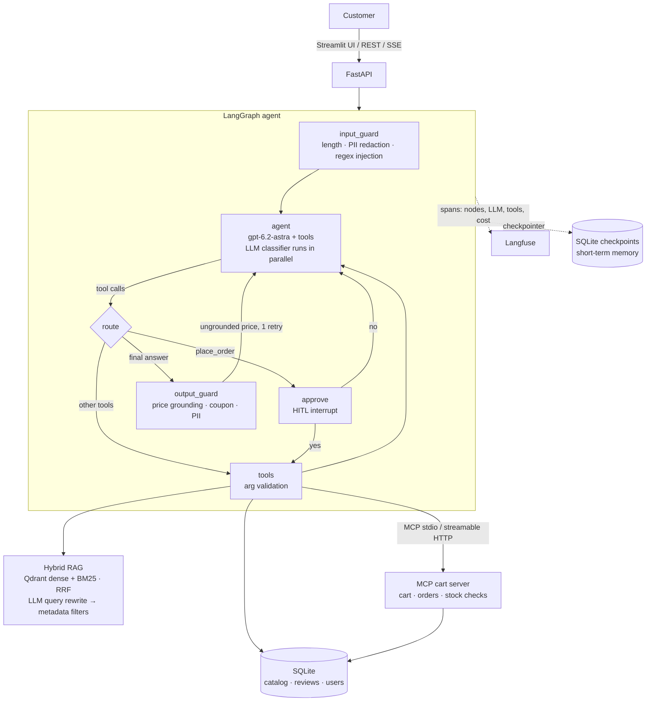

# LaptopHub Shopping Agent

A single-agent shopping assistant that helps customers **choose, compare and buy laptops**.
It runs on **LangGraph** and uses **hybrid RAG**, an **MCP** cart/order service, **human-in-the-loop** checkout, layered **guardrails**, **Langfuse** tracing, and an automated **eval + regression gate** in CI.

> Capstone project, *Advanced Agent Engineering* course. The catalog (200 laptops, 605 reviews, 4 policy documents) is synthetic and generated from a fixed random seed, so eval ground truth is known and runs are reproducible.

## Why an agent, and why a single agent?

Filter-based shop search fails on real requests such as *"light laptop with all-day battery for university, under $1000"*. The need has to be turned into specs, matched against reviews and policies, compared, and then acted on (cart, order).

That calls for an agent with tools rather than a fixed pipeline. A **single agent** is enough for this flow: it is mostly one sequence of steps, so splitting it into multiple agents would add latency, cost and debugging surface with no quality gain. Control-flow concerns (safety checks, order approval, answer validation) live as **explicit graph nodes**, not as extra agents.

## Architecture



| Layer | Implementation |
|---|---|
| Orchestration | LangGraph `StateGraph`, 5 nodes. SQLite checkpointer stores conversation memory per thread. Long-term memory (budget, OS, use case, brand) is persisted per user. Since **prompt v3** it is extracted by a cheap model **in the background after the answer**, so it no longer costs an agent LLM round. |
| Loop safety | Each turn allows at most 6 tool rounds, after which the agent is forced to answer. `recursion_limit=12` is a hard stop. |
| HITL | `interrupt()` before `place_order` shows the cart and waits for yes/no. Resumed via `Command(resume=...)`. |
| Tools (13) | `search_products`, `get_product_details`, `compare_products`, `search_reviews`, `search_policies`, `check_stock_price` (RAG + SQL), `convert_price` (**external live exchange-rate API**: 5s timeout, 1h cache, stale/static fallback), plus 5 cart/order tools served by an **MCP server**. (`remember_preference` was an agent tool in prompt v1/v2.) |
| RAG | One Qdrant collection, separated by `doc_type` metadata. Dense and BM25 results are fused with RRF. An LLM rewrites the query into structured filters. Filters relax step by step but **never relax budget, brand, OS or stock**. Retrieval only finds candidates; prices and stock are re-read from SQL. |
| Guardrails | **Input:** length limit, PII redaction, regex fast-path, LLM classifier (aware of conversation context). **Tool:** id/qty/price validation before execution. **Output:** every $ amount and every spec value (GB/TB, kg, hours, Hz, inch) must come from tool results or the customer, otherwise one corrective retry; no invented coupon codes. `user_id` is injected from config and never visible to the LLM. |
| Models | `gpt-6.2-astra` (main) → `gpt-5.4` (automatic fallback). `gpt-5.4-nano` handles rewrite and classification. All calls go through the Responses API. |
| Observability | Langfuse: one trace per turn, spans for every node, LLM call and tool, tagged with user, session, `prompt:v2` and model. **Langfuse Prompt Management**: system prompt versions v1/v2 are published (`scripts/push_prompts.py`, label `production` = active), fetched at runtime with an in-code fallback, and every generation is linked to its prompt version. Eval cost per case is pulled from Langfuse (`evals/fetch_costs.py`). |

## Results (from `evals/reports/`)

**Retrieval** (30 queries, top-5; a result is relevant if it satisfies every spec constraint)

| Variant | P@5 | Hit@1 | MRR | p50 latency |
|---|---|---|---|---|
| v1 dense only | 0.520 | 0.533 | 0.634 | 0.4s |
| v2 hybrid (BM25 + dense, RRF) | 0.587 | 0.667 | 0.726 | 0.4s |
| **v2 + query rewrite → filters** | **0.840** | **0.933** | **0.933** | 3.1s |
| v2 + LLM rerank | 0.853 | 0.967 | 0.967 | 5.6s |

Rerank adds +1pt P@5 for +2.5s, so it is **disabled** in production (`RAG_RERANK=false`).

**Agent** (40, later 42 cases: recommend, memory, compare, policy, cart/HITL, safety, false positives; checks are deterministic, plus LLM-as-judge)

| Run | Pass rate | Tool acc. | Safety block | False positives | Judge faithfulness | Latency p50 / p95 |
|---|---|---|---|---|---|---|
| baseline | 0.925 | 0.968 | 1.0 | 0 | 3.59 | 17.7s / 42.0s |
| fix1 (guard context, eval isolation, judge input) | 0.975 | 1.0 | 1.0 | 0 | 4.47 | 16.3s / 33.4s |
| optimized (prompt v2, parallel guard, no rerank, caching) | 1.0 | 1.0 | 1.0 | 0 | 4.24 | 11.6s / 19.0s |
| **final run 1** (+ FX API tool, spec guard, stronger judge `gpt-5.4`; 42 cases) | **1.0** | **1.0** | **1.0** | **0** | **4.86** | 11.4s / 23.2s |
| **final run 2** (identical config, repeat run for variance) | **1.0** | **1.0** | **1.0** | **0** | **4.83** | 11.7s / 20.9s |

| **v3: memory off the critical path** (+14 adversarial cases, 56 total) | **1.0** | **1.0** | **1.0** (21/21 safety) | **0** | 4.78 on the same 42 cases | 12.2s / 25.6s |
| v3 + router cascade (gpt-5.4 for the tool-routing round) | 0.982 | 0.971 | 1.0 | 0 | 4.64 on the same 42 | **9.4s / 20.2s** |

The **cascade** was 22% faster but regressed one case: the router asked for a budget instead of searching. Quality comes first, so it ships **off** (`ROUTER_MODEL=""`). Prompt v3 cut agent tokens by 21% and cost by 13% at unchanged quality.

**Single user** (sequential, streaming, Docker, 6 typical turns): p50 **10.1s**, time to first token p50 **7.1s**. Injection is blocked in 0.3s. Product recommendations are the slowest turns (14–20s) because they take 2–3 LLM rounds.

**Outage drill:** the OpenAI account once ran out of credits. That exposed two bugs, both fixed: the SSE stream dropped the connection, and the API refused to start because warm-up failed. Now the stream ends with a user-safe error event and the API boots without the provider.

Repeat runs are stable on every deterministic metric. Latency p50 stays near 11.5s, while p95 varies by about ±2s with OpenAI load. **Cost: about $0.015 per conversation case** (Langfuse, all models included; about $0.64 per 42-case eval run). The judge-faithfulness jump from 4.24 to 4.85 mostly reflects the stronger judge, which no longer makes the arithmetic mistakes the `gpt-5.4-mini` judge made.

**Model comparison** (same 40 cases, optimized pipeline)

| Model | Pass rate | Tool acc. | Judge faithf. | p50 / p95 | Agent tokens/case | Typical failure |
|---|---|---|---|---|---|---|
| **gpt-6.2-astra** (main) | **1.0** | **1.0** | 4.24 | 11.6s / 19.0s | 3548 | none |
| gpt-5.4 (fallback) | 0.95 | 0.968 | 4.74 | 7.7s / 12.9s | 3014 | quoted a wrong "cheapest" laptop; asked instead of searching |
| gpt-4o | 0.925 | 0.935 | 4.56 | 6.8s / 9.1s | 2336 | asks for budget instead of searching (3 cases) |

Bugs found by the eval and fixed: (1) the input guard blocked follow-ups such as *"options for programming?"* because it had no conversation context; (2) long-term memory leaked between eval cases; (3) the output guard flagged budgets the customer had stated; (4) the agent suggested over-budget laptops (fixed by **prompt v2**).

## Quickstart

```bash
cp .env.example .env            # add OPENAI_API_KEY (+ LANGFUSE_* keys for tracing)

# Docker (recommended)
docker compose up --build       # UI → http://localhost:8501   API docs → http://localhost:8000/docs

# or locally
python -m venv .venv && .venv/bin/pip install -e ".[dev]"
.venv/bin/python scripts/generate_data.py && .venv/bin/python scripts/load_db.py
.venv/bin/python -m laptop_agent.rag.index
.venv/bin/uvicorn laptop_agent.api.main:app --app-dir src --port 8000
API_URL=http://localhost:8000 .venv/bin/streamlit run ui/app.py      # sidebar: customer switch, live long-term-memory card, one-click demo prompts
.venv/bin/python scripts/chat_cli.py          # terminal chat
```

Tests and evals:

```bash
.venv/bin/pytest -q                                            # 27 offline tests: DB, tools, MCP, FX fallback, memory, guardrails, routing, rate limit
.venv/bin/python evals/run_retrieval_eval.py                   # RAG v1 vs v2 variants
.venv/bin/python evals/run_agent_eval.py --label mine --gate   # 40-case agent eval + regression gate
.venv/bin/python evals/run_agent_eval.py --label m --model gpt-5.4   # same eval, other model
.venv/bin/python evals/compare_reports.py optimized mine       # side-by-side table
```

CI (`.github/workflows/eval.yml`) runs unit tests on every push. Retrieval eval, agent eval and the **regression gate** (`evals/thresholds.json`) run on pull requests and on manual dispatch, and publish their reports to the job summary.

## Project layout

```
src/laptop_agent/
  agent/       graph.py (nodes + routing) · prompts.py (versioned) · runtime.py (chat/resume/stream)
  rag/         index.py (Qdrant build) · retriever.py (v1, v2: rewrite, hybrid, RRF, filters, rerank)
  tools/       catalog.py (RAG + SQL tools) · cart.py (MCP client tools) · memory.py
  mcp_cart/    server.py (FastMCP cart & order server, stdio or HTTP)
  guardrails/  checks.py (input / tool-call / output checks)
  api/         main.py (FastAPI: /chat, /chat/confirm, /chat/stream, /health)
  config.py · llm.py (fallback) · observability.py (Langfuse)
evals/         datasets/*.jsonl · run_*_eval.py · thresholds.json · reports/
tests/         offline unit tests
ui/app.py      Streamlit demo
```

## Production notes and limitations

- Config comes from the environment (12-factor). Services are containerized; the MCP cart runs as its own service over HTTP.
- SQLite and embedded Qdrant keep the demo self-contained. To scale, swap in Postgres (also usable as the LangGraph checkpointer) and a Qdrant server; the code paths are unchanged.
- The API expects an authenticated `user_id`. A real deployment would derive it from auth (JWT/session) rather than from the request body.
- Rate limiting is per process (20 messages/min/user). Several API replicas would need a shared store such as Redis.
- Recommendation turns need 2–3 LLM rounds (14–20s). The router cascade is implemented but fails the eval, so it is disabled. Next steps: a second LLM provider for failover, and conversation summarization for long chats.
- LLM-judge scores are a trend signal; the deterministic checks are the primary regression gate.
